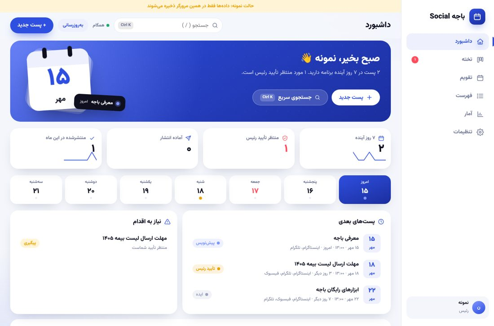
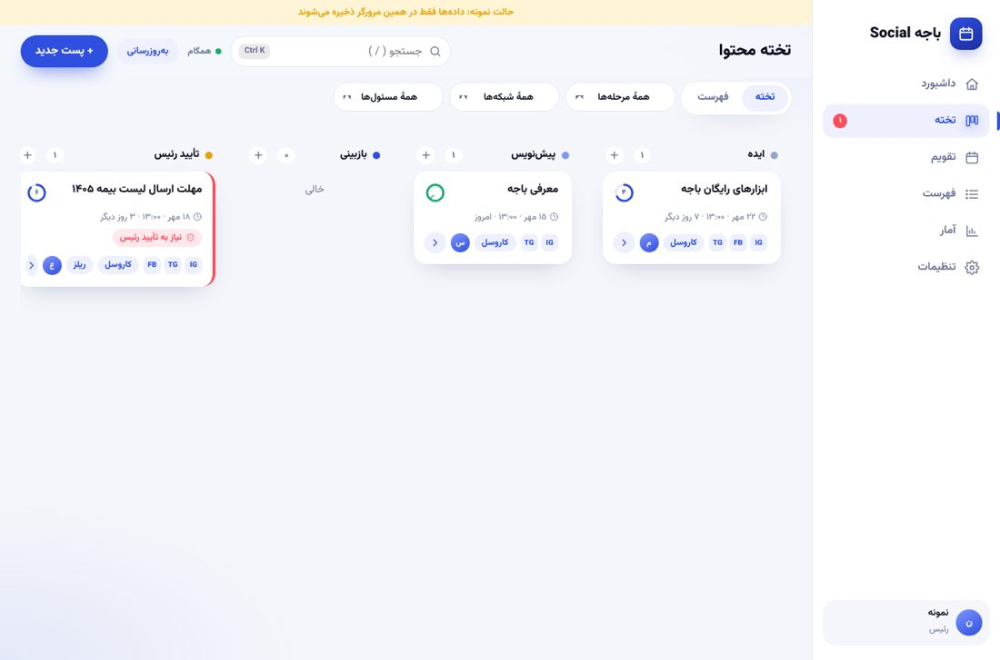
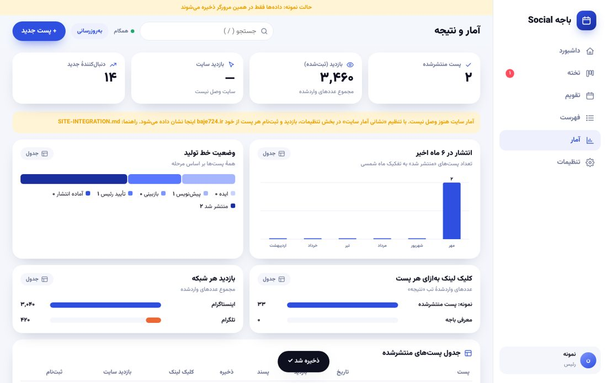
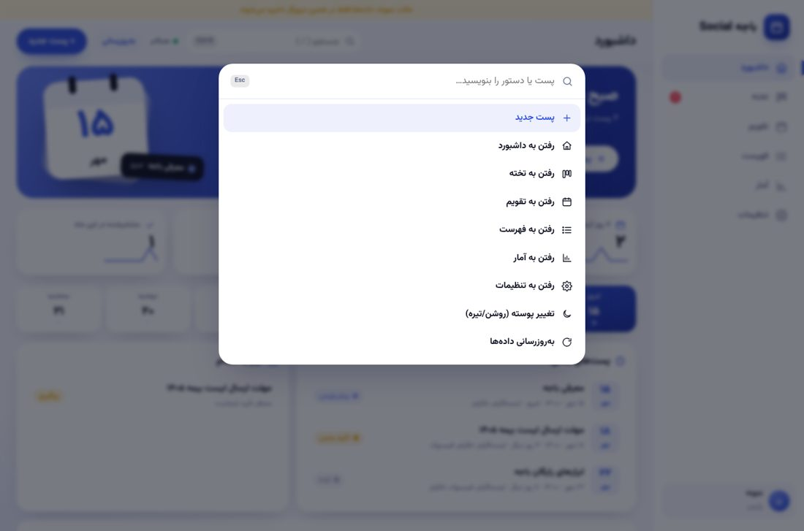
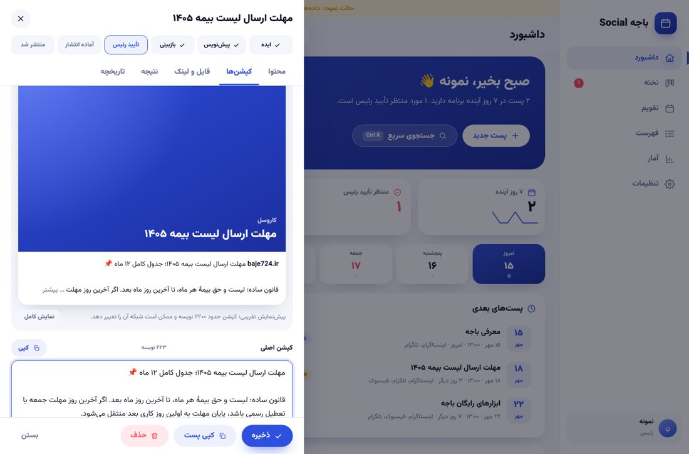

# هستهٔ محتوای باجه (Hub)

یک وب‌اپ فارسی برای تیم Social: داشبورد، تخته با کشیدن و رها کردن، تقویم شمسی، فهرست، ویرایشگر کپشن‌ها، لینک رهگیری (UTM) برای هر شبکه، قفل تأیید رئیس برای متن‌های بیمه، و صفحهٔ آمار با نمودار. روی موبایل و دسکتاپ کار می‌کند و روی موبایل قابل «افزودن به صفحهٔ اصلی» است.

## امکانات تازه (ارتقای دوم)
- **پالت دستور** با `Ctrl/⌘ + K`: جستجوی پست و اجرای دستور (پست جدید، رفتن به صفحه‌ها، تغییر پوسته).
- **حلقهٔ آمادگی** روی هر کارت و نوار آمادگی در ویرایشگر: عنوان، تاریخ، شبکه، قالب، کپشن، فایل و (برای پست بیمه) تأیید رئیس؛ آنچه کم است قابل کلیک است.
- **پیش‌نمایش کپشن** شبیه اینستاگرام و تلگرام با شمارندهٔ نویسه و هشدار حد؛ حدها تقریبی‌اند و شبکه‌ها می‌توانند عوضشان کنند.
- **نوار هفته**، هیرو با استیکر تقویم (امضای طراحی باجه)، شمارندهٔ متحرک و اسپارک‌لاین.
- دکمهٔ «+» بالای هر ستون تخته، «برگردان» بعد از جابه‌جایی مرحله، و آتش‌بازی کوچک وقتی پست «منتشر شد» می‌شود.
- با `prefers-reduced-motion` همهٔ حرکت‌ها خاموش می‌شوند.

## چطور کار می‌کند
- **بدون سرور و بدون هزینه:** خود برنامه فقط چند فایل ثابت است (HTML/CSS/JS). داده‌ها در همان مخزن خصوصی GitHub ذخیره می‌شوند: هر پست یک فایل `team/posts/<id>.json`.
- **ورود:** هر عضو یک‌بار توکن GitHub می‌سازد (Fine-grained token، فقط همین مخزن، دسترسی Contents: Read and write) و در صفحهٔ ورود می‌گذارد. توکن فقط در مرورگر خودش می‌ماند.
- **تاریخچه و پشتیبان رایگان:** هر ذخیره یک commit است.
- **دو نقش:** «ادمین» (کار روزانه) و «رئیس» (تأیید پست‌های بیمه/تاریخ و عبور از مرحلهٔ «تأیید رئیس»). نقش رئیس با رمز محافظت می‌شود و قفل‌ها فقط راهنمای داخل برنامه‌اند؛ کسی که توکن دارد از نظر فنی می‌تواند فایل‌ها را مستقیم تغییر دهد. جزئیات: [TEAM-SETUP.md](TEAM-SETUP.md).

## اجرای آزمایشی (بدون ورود)
فایل `index.html` را باز کنید و «نمایش نمونه» را بزنید، یا آدرس `index.html?demo`. داده‌های نمونه فقط در همان مرورگر می‌مانند. برای اجرای محلی با سرور: `python -m http.server` داخل پوشهٔ `hub` و باز کردن `http://localhost:8000`.

## انتشار روی GitHub Pages (رایگان)
۱. یک مخزن **عمومی** جدید بسازید (مثلاً `baje-hub`) و محتوای همین پوشه (`index.html`، `css`، `js`، `fonts`، `manifest.webmanifest`، `icon.svg`) را در آن بگذارید. فقط کد برنامه است؛ هیچ دادهٔ تیم یا توکنی داخلش نیست.
۲. Settings ← Pages ← Source: `main` / root.
۳. آدرس `https://<نام‌کاربری>.github.io/baje-hub/` را در مرورگر همهٔ اعضا باز کنید و به صفحهٔ اصلی گوشی اضافه کنید.
چرا مخزن جدا و عمومی: طبق اطلاعات من Pages برای مخزن خصوصی در پلن رایگان GitHub نیست. شرایط فعلی را GitHub چک کنید.
هر عضو باید دعوت‌شده به مخزن دادهٔ خصوصی باشد (Settings ← Collaborators) و حساب GitHub داشته باشد.

## افزودن اعضا و تعیین رئیس
راهنما: [TEAM-SETUP.md](TEAM-SETUP.md) (مشکل توکن همکارها، سازمان رایگان، تعیین رئیس، پیام آمادهٔ ارسال).

## اتصال به سایت و آمار
راهنمای کامل: [SITE-INTEGRATION.md](SITE-INTEGRATION.md). خلاصه: لینک‌های UTM را برنامه می‌سازد؛ سایت باید آن‌ها را ثبت کند و (اختیاری) یک نقطهٔ JSON برای آمار بدهد.

## محدودیت‌ها
- آزمون‌های خودکار این برنامه با GitHub شبیه‌سازی‌شده انجام شد، نه با GitHub واقعی؛ اولین ورود واقعی باید در کانال آزمایشی انجام شود.
- هم‌زمانی لحظه‌ای ندارد: برای دیدن تغییر دیگران «به‌روزرسانی» را بزنید. اگر دو نفر هم‌زمان یک پست را ذخیره کنند، دومی پیام تعارض می‌گیرد و فهرست دوباره بارگذاری می‌شود.
- **پیوست تصویر و فایل:** در تب «فایل و لینک» هر پست؛ تصویر بزرگ خودکار فشرده می‌شود (حداکثر ۲۴۰۰ پیکسل) و فایل‌ها در `team/files/<شناسهٔ پست>/` همان مخزن ذخیره می‌شوند. هر فایل حداکثر ۲۰ مگابایت. ویدیو و ریلز آپلود نمی‌شود (مخزن برای فایل سنگین مناسب نیست)؛ لینک Google Drive یا مشابه بگذارید. توصیهٔ GitHub برای اندازهٔ کل مخزن حدود ۱ گیگابایت است؛ این را زیر نظر داشته باشید.
- فایل با دکمهٔ «ذخیره» آپلود می‌شود؛ اگر پنجره را بدون ذخیره ببندید چیزی آپلود نشده است.
- انتشار روی شبکه‌ها دستی است. این برنامه زمان‌بندی و اجرا نمی‌کند، فقط همه‌چیز را برای انتشار آماده و ثبت می‌کند.

## امنیت: چه چیزی عمومی است و چه چیزی نه
- **عمومی:** فقط مخزن `baje-hub` (کد برنامه) و آدرس Pages. هیچ داده، توکن یا نام مخزن داده در آن نیست؛ فیلد «مخزن داده» در صفحهٔ ورود خالی است و هر مرورگر پس از اولین ورود خودش آن را به‌خاطر می‌سپارد.
- **خصوصی:** مخزن داده (پست‌ها، کپشن‌ها، فایل‌ها، پشتیبان‌ها). بدون توکنِ عضو دعوت‌شده خوانده نمی‌شود. تنظیمات ← «فضا و امنیت مخزن» اگر مخزن داده عمومی شود هشدار قرمز می‌دهد.
- **توکن:** فقط در `localStorage` مرورگر همان عضو است؛ سقف دسترسی فقط یک مخزن و Contents؛ تاریخ انقضا دارد. اگر دستگاه گم یا مشترک شد، توکن را در GitHub حذف (Revoke) کنید.
- **سخت‌سازی صفحه:** سیاست امنیت محتوا (CSP) اسکریپت درون‌خطی و منبع بیرونی را مسدود می‌کند و `referrer` ارسال نمی‌شود. با این حال هر کسی که به مخزن دسترسی نوشتن دارد همه‌چیز را می‌بیند و می‌تواند تغییر دهد؛ فقط افراد مورد اعتماد را دعوت کنید. کد برنامه را فقط از مخزن خودتان بارگذاری کنید و هر تغییر آن را بازبینی کنید، چون برنامه توکن را می‌خواند.
- فایل‌های نهایی و سنگین (سورس طراحی، ریلز) را در Google Drive یا Dropbox نگه دارید و لینکشان را بگذارید؛ در هسته فقط پیش‌نمایش سبک.

## لینک رهگیری، فوتر پیام و انتخابگر تاریخ
- **UTM قابل‌تنظیم:** در ویرایشگر پست، تب «فایل و لینک»: روشن/خاموش کردن لینک، medium/campaign/content/term، source جدا برای هر شبکه یا یک لینک کامل دلخواه. مقدار خالی یعنی پیش‌فرض.
- **فوتر پیام:** قالب در تنظیمات ← «فوتر پیام» (فایل `team/templates.json`)، یکی برای همه و اختیاری برای هر شبکه. جانشین‌ها: `{link}` `{title}` `{site}` `{channel}`. هر پست جدا تصمیم می‌گیرد فوتر داشته باشد یا نه (و می‌تواند متن اختصاصی بگذارد). ترتیب متن: کپشن، فوتر، لینک (اگر در فوتر `{link}` نباشد). ناشر (`publisher/publish.mjs`) همین منطق را اجرا می‌کند.
- **انتخابگر تاریخ و ساعت:** روی فیلد تاریخ/ساعت بزنید (روی گوشی به‌شکل برگهٔ پایین). تایپ دستی هم کار می‌کند.
- **تقویم:** نمای ماه، هفته و برنامه؛ ساعت و رنگ مرحله روی هر پست؛ زدن روی هر روز پست تازه همان روز می‌سازد.
